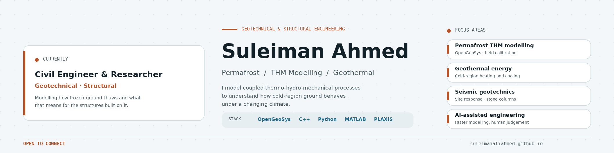

# Suleiman Ahmed

**Civil Engineer & Researcher | Geotechnical and Structural Engineering | Permafrost THM Modelling**

---

## About

Civil engineer and researcher, passionate about geotechnical and structural engineering. I model how frozen ground thaws and what that does to the structures built on it, using coupled thermo-hydro-mechanical (THM) simulation calibrated against field data. Outside the models I write code and follow how AI is changing the way engineers work.

## What I work on

- **Permafrost THM modelling:** degradation, ground stability and cold-region infrastructure, built in OpenGeoSys (field case: Norman Wells, NWT).
- **Geothermal energy in cold regions:** subsurface characterisation for low-carbon heating and cooling.
- **Seismic geotechnics:** non-linear site response of stone-column-improved soils.
- **AI-assisted engineering** 

## Tech stack

| Area | Tools |
|---|---|
| Numerical and multiphysics | OpenGeoSys, ABAQUS, ANSYS, PLAXIS, FLAC, COMSOL, MFront, DEEPSOIL |
| Programming | Python, C/C++, Fortran, MATLAB, SQL |
| Structural design | ETABS, AutoCAD, Eurocodes 1, 2, 7 and 8 |

## Recent papers

- Ahmed, S., & Li, B. (2026). *Pore-Water Salinity Effects on Seasonal Dynamics of Active Layer and Permafrost at Norman Wells, NWT, Canada, Using a Thermo-Hydro-Mechanical Model.* GeoQuébec 2026.

## Let's connect

I am always ready to connect with people. Whether you work in geotechnical engineering, permafrost or AI-assisted engineering, or you simply want to say hello, find me on [LinkedIn](https://www.linkedin.com/in/suleimanaliahmed/) or visit my [portfolio](https://suleimanaliahmed.github.io/).
